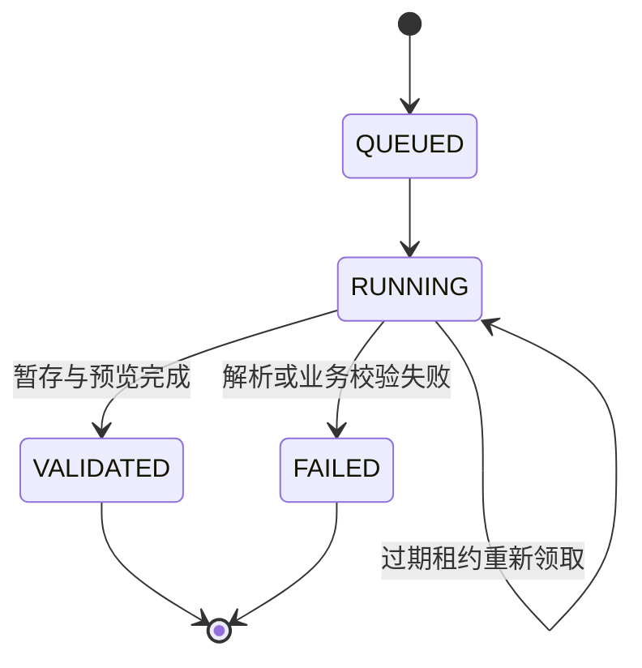
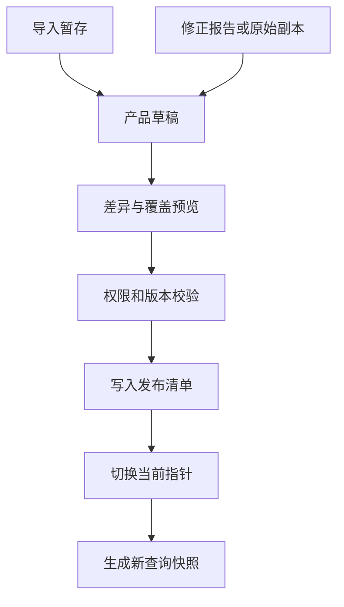

# 财经权限审查报告系统：一期详细设计

版本：P1 V1.0.0；日期：2026-10-16。依据已确认的《详细架构设计 V1.0》Word 正式稿落实到代码。本文为一期实现说明，原架构稿继续作为总体架构基准。

## 1. 交付结果与边界

本期将已认可的 Vue 界面接入 Java 模块化单体，提供文件上传、服务端校验、双类风险明细、原始记录追溯、报告纠错、原始副本修订、草稿、原子发布、回退、快照查询、导出和产品范围鉴权。上传原文件、数据集、发布版本分别保存。

正式运行版由 Java 同源提供 Vue 页面与 API。`frontend/` 为运行版，独立在线高保真原型不连接正式数据库，其源码随原交付包保留；本仓库收录正式运行工程。首页按本次标注使用“FINANCE ACCOUNT PERMISSION AUDIT”“财经权限，全量审查”“8项用户权限检查·6项权限矩阵明细检查”。检查结果仍只呈现有明确输入定义的规则，不因为标题增加自动执行项。当前目录为用户角色检查1—7、矩阵8a—8f；自动审查与规则口径核定在二期接入。

| 本期已实现 | 后续接入 |
| --- | --- |
| 四类核心数据接入、按产品范围替换 | iAuth 原始接口与周期采集 |
| 两条风险与原始数据追溯链路 | Python 审查 Worker |
| 原始副本修订、报告修正、误报确认 | 复核后关闭风险、生产权限整改回执 |
| 本地配置身份、角色和产品范围 | 企业统一认证协议与真实产品授权来源 |
| H2 文件数据库体验配置、PostgreSQL连接配置 | 企业数据库、共享文件存储与运维集成 |

系统不执行用户上传的 Python、宏、公式或 Excel 超链接，不改写生产 iAuth 权限。修改后待复核不代表已完成整改。

## 2. 工程结构与技术基线

| 路径 | 责任 |
| --- | --- |
| `frontend/index.html`、`styles.css`、`app.js` | Vue 页面、状态、交互与 API 调用 |
| `frontend/api.js` | HTTP、Basic 身份、CSRF 令牌、下载；凭据只留在内存 |
| `frontend/vendor/` | 随包提供 Vue 3.5.22；无需 CDN |
| `server/src/main/java/cn/finance/review` | Java 应用服务 |
| `server/src/main/resources/db/migration` | Flyway 数据库迁移 |
| `server/src/test` | Spring 集成测试及安全、解析和发布回归 |
| 在线交互原型（独立交付） | 在线地址及原交付包保留，与本仓库 Java 运行版区分 |
| `pom.xml` | Java 17、Spring Boot 3.5.16、JDBC、Security、Flyway、Apache POI 5.5.1 |

一期不要求 Redis、消息队列、搜索集群和 Python。解析与导出由 Java 后台任务处理，业务查询使用独立 HTTP 请求线程。数据库保存任务状态、租约与结果，不依赖页面持续打开。依赖版本是本次构建基线，企业交付时可按准入目录替换并重新验证。

## 3. 页面详细设计

| 页面 | 查询上下文 | 核心操作 | 状态 |
| --- | --- | --- | --- |
| 登录 | 已配置账号 | 登录、错误提示 | 未认证、认证失败、加载中 |
| 全域概览 | 固定快照、当前产品范围 | 指标下钻、产品排序、刷新快照、全域导出 | 未提供、部分覆盖、已发布 |
| 产品审查 | 产品、快照 | 按检查项下钻、导出结果 | 违规、存在风险、需人工确认、未检出记录、未提供 |
| 风险明细 | 产品、链路、快照、筛选 | 每字段筛选、关键/全部字段、分页、导出、原始记录下钻 | 当前有效风险、已确认误报、待复核 |
| 原始数据 | 产品、链路、快照 | 原始记录检索、独立编辑、来源追溯 | 无风险关联也可查看与修订 |
| 数据管理 | 产品范围 | 上传、查看任务、草稿预览/发布/放弃、原始数据、发布历史 | 校验中、校验失败、待发布、已过期草稿 |
| 详情侧栏 | 风险或原始记录ID、快照 | 审查时数据与当前副本切换、修正报告、编辑副本、下载来源文件 | 未关联、编辑中、草稿未发布 |
| 发布窗口 | 草稿ID、草稿版本、基础发布版本 | 看差异、填写原因、确认完整空清单、发布 | 正常、版本冲突、发布失败 |

所有统计与下钻使用同一 `snapshotId`。发布成功后主动生成新快照并同步刷新；已经打开的旧快照仍可复现旧版数据。前端不使用 localStorage 保存运行版业务数据或密码。

## 4. 角色与数据范围

本期账号适配器提供以下可运行身份。密码在正式配置中通过环境变量传入，运行时使用 BCrypt 编码。

| 账号/角色 | 默认产品范围 | 查询/导出 | 上传/修订 | 发布/回退 |
| --- | --- | --- | --- | --- |
| `leader` / LEADER | 全部18产品 | 是 | 否 | 否 |
| `aa` / AA | 全部18产品 | 是 | 是 | 是 |
| `quality` / QUALITY | 全部18产品 | 是 | 是 | 是 |
| `product` / PRODUCT | `PRODUCT_SCOPE`，默认P06 | 是 | 是 | 否 |
| `platform` / PLATFORM | 无财经数据范围 | 否 | 否 | 否 |

每一个后端查询、编辑、发布、文件和导出下载都校验身份及范围；跨产品查询、统计、快照也使用相同范围。请求越界对象统一返回404，操作权限不足返回403。访问控制集中在 `Access`；企业统一认证接入时应从可信身份源生成相同的角色与产品范围，不能信任浏览器传入的角色或产品清单。

身份认证使用同源 HTTP Basic，并对写入启用 CSRF。无状态Basic模式使用空的会话认证策略，避免每个已认证GET请求反复清除CSRF Cookie；写请求仍严格校验Cookie与令牌。前端先获取 `/api/csrf`，随后发送 Cookie 和令牌请求头；凭据只存在当前页面内存中。正式网络入口需使用 HTTPS。体验配置仅监听本机。

## 5. 数据模型与表设计

| 表 | 主键/约束 | 业务用途 |
| --- | --- | --- |
| `product` | `id` | 18个产品目录与图标 |
| `file_asset` | `id`，产品范围、摘要、存储名 | 不可变上传文件证据 |
| `review_dataset` | `id`，产品、链路、状态 | 一条链路的原始数据与风险版本、各自覆盖与时点 |
| `source_auth` | `id`；`dataset_id + record_key` 唯一 | 原始用户—角色授权事实 |
| `source_point` | `id`；`dataset_id + record_key` 唯一 | 角色—权限集—权限点绑定事实 |
| `risk_finding` | `id`，数据集/链路/规则索引 | 风险共性字段、核实状态、审查/当前源记录引用 |
| `user_role_finding` | `finding_id` | 用户角色风险的审查时字段快照 |
| `matrix_finding` | `finding_id` | 矩阵风险的角色/权限集/权限点字段快照 |
| `review_draft` | `id`、基础版本、草稿修订号 | 修改候选，引用受影响链路的数据集 |
| `product_release` | `id`、发布序号 | 发布清单，引用两条链路的数据集 |
| `product_publication` | `product_id` 唯一 | 当前发布指针、并发版本 |
| `snapshot`、`snapshot_entry` | 快照范围摘要；快照+产品 | 固定各产品发布版本的查询上下文 |
| `import_job` | 用户+产品+幂等键唯一 | 上传任务、校验、进度、租约、错误、预览 |
| `export_job` | `id`、快照、用户 | 异步导出与受控下载 |
| `audit_event` | `id`；产品+时间索引 | 操作者、原因、前后值与版本事件 |
| `publish_request` | 用户+产品+幂等键 | 发布请求幂等结果 |

DDL 的字段类型、索引和约束以 `V1__core.sql` 为准。风险结果采用公共主表加类型明细表；业务字段为具名列。JSON仅用于任务预览、错误、导出筛选和修改前后值。

`audited_source_id` 引用审查时不可变记录；`current_source_id` 引用当前副本。原始文件位置保留 `source_asset_id/source_sheet/source_row`。普通编辑不允许改产品、内部ID、检查项编号及审查来源版本。

## 6. 四类数据契约

| 输入对象 | 标准Sheet | 标准化对象 | 关键标识 |
| --- | --- | --- | --- |
| 原始授权 | 原始权限明细数据 | SourceAuth | 来源系统、应用、租户、授权ID；无授权ID时使用明确范围内的候选组合 |
| 用户风险 | 违规记录明细 | RiskFinding + UserRoleFinding | 检查项+原始授权对象 |
| 原始权限点 | 原始权限点明细数据 | SourcePoint | 应用、租户、角色、权限集、权限点绑定 |
| 矩阵风险 | 权限矩阵检查结果 | RiskFinding + MatrixFinding | 检查细项+绑定对象 |

字段别名、日期、置信度、必填列和枚举集中在 `Fields`，Sheet识别在 `WorkbookCodec`。按表头特征识别核心数据并兼容历史Sheet名称，不依赖Sheet序号；辅助Sheet可忽略。一个工作簿可以同时提供两条链路，发布时一起切换。

- 字符串工号、部门编码、授权ID和权限点ID保留前导0；科学计数的关键标识要求重新按文本导出。
- 日期接受规范文本和Excel日期单元格；有效期接受明确的长期标识。
- 置信度允许0—1或百分数；空值保留未知，不制造分类置信度。
- 用户风险检查项1—7；矩阵8a—8f，历史10a—10f映射为8a—8f。
- 人员稳定键使用有边界的元组编码；仅employee命名空间内的字母加数字工号做大小写归一，其他账号保持原文，不做补00合并。人员类别、是否雇员分别保存。未知和分类冲突单列，不把雇员判断的补00逻辑用于人员主键。
- 表头、业务日期、重复、范围冲突、置信度和状态错误会阻止发布；错误返回Sheet、原始行号及说明，最多展示100条错误样例并保留总错误数。

仅上传风险时保留原始统计基线及其时点，但不自动把历史原始数据认定为本次风险的审查证据。配对上传时按明确范围和业务键建立唯一关联；缺失匹配显示未关联。

## 7. 文件导入与任务状态

`POST /products/{id}/import-jobs` 在校验产品权限后保存原文件与SHA-256，记录任务及基础发布版本，立即返回202。后台按数据库条件更新领取任务；解析不占用发布事务。解析过程中刷新租约，持有租约的工作者才可提交暂存结果。

XLSX采用POI SAX事件解析，遍历实际单元格与非空行；XLS使用行迭代；CSV支持UTF-8、BOM、引号、逗号和换行。文件上限50MB；每类原始数据100,000行，每类风险20,000行；超限失败，不静默截断。公式单元格要求转换为静态值。原文件存储名为服务端生成，不使用客户端路径。

暂存事务为受影响链路复制基础数据集，替换本次识别的对象；未上传的对象保留。只上传用户风险不会删除原始授权或矩阵结果。若导入任务基础版本落后，候选仍可保留预览，发布会返回冲突。

## 8. 草稿、编辑与发布

草稿记录 `base_release_id/base_revision` 和自身 `revision`。记录更新使用 `If-Match: record_version`；发布使用草稿修订号。缺少强制版本条件返回428，版本过期返回412。

- 原始副本修订：只更新草稿副本，所有关联风险改为待复核，原审查依据保留。
- 报告修正：只开放检查项显示名、风险等级、核实状态、违规说明、建议、依据和置信度；必须填写原因。
- 误报确认：已确认误报从当前有效风险数中排除，原命中和修改事件仍保留；可通过核实状态筛选查看。
- 发布：锁定产品当前指针，核对基础版本和草稿版本；写入发布清单、指针及事件后同一事务提交。
- 幂等：相同用户、产品、请求键及请求摘要返回原结果；同键不同内容返回409。
- 空清单：完整0条风险须额外明确确认；0条只表示清单未检出，不自动判定全部检查通过。
- 回退：创建引用旧数据集的新发布记录，保留中间版本与来源时间。

两类数据可以分别更新，另一链路继续引用原数据集。发布失败和导入失败均不改变当前看板。并发发布冲突时不自动合并覆盖，需重新以当前版本形成候选。

## 9. 指标与查询口径

| 指标 | 计算 | 数据不足时 |
| --- | --- | --- |
| 授权记录 | 已覆盖原始授权行数 | 未提供显示“—”；部分覆盖明确提示 |
| 总用户 | 原始授权的用户命名空间+账号稳定键去重 | 不从违规清单反推，不求产品人数之和 |
| 云山/业务雇员/业务非雇员 | 来源人员分类与雇员身份组合 | 其他、未知、冲突单列 |
| 当前有效风险 | 当前清单中未标记已确认误报的记录 | 与默认明细条件一致 |
| 原始命中 | 当前结果版本内全部风险发现 | 与有效风险并列保留 |
| 待复核 | 核实状态为待复核 | 只修订副本不自动清零 |
| 产品结果覆盖 | 有已发布数据集的产品数 | 不表述为所有规则都已执行 |
| 检查项结果 | 有风险按规则性质展示 | 0条为“未检出记录”，无数据为“未提供” |

筛选、总数、分页和导出使用同一字段映射白名单。支持contains、eq、in、gte、lte，排序仅接受标准字段；所有参数绑定，不接受SQL片段。分页最终加入内部记录ID排序，快照内结果稳定。每页1—100条。

## 10. API 明细

全部接口位于 `/api`；静态文件与接口同源。除模板和字段规则外，数据接口均校验产品范围。

| 方法与路由 | 输入与输出 |
| --- | --- |
| GET `/me`、`/csrf` | 身份/范围/操作能力；CSRF令牌与请求头名 |
| POST `/snapshots` | 创建固定范围的版本向量 |
| GET `/dashboard?snapshotId=` | 指标、产品统计、各链路覆盖与来源时点 |
| POST `/findings/query` | snapshotId、productId、kind、filters、分页；返回rows/total/counts |
| POST `/source-records/query` | 相同查询契约，查询原始记录 |
| GET `/findings/{id}` | 指定快照的风险、审查源记录、当前副本、修改记录 |
| GET `/source-records/{id}` | 指定快照、kind的独立原始记录 |
| GET `/templates/{user|matrix|all}` | 标准Excel模板及填写说明 |
| POST `/products/{id}/import-jobs` | multipart文件、mode、覆盖、来源时间；Idempotency-Key |
| GET `/import-jobs`、`/{id}`、`/{id}/errors` | 任务列表、校验结果、错误CSV |
| POST `/products/{id}/drafts` | 复制user、matrix或both链路形成草稿 |
| GET `/drafts`、`/{id}` | 待发布候选；旧/新数量、未关联、待复核、覆盖 |
| GET `/drafts/{id}/record` | 从原记录定位草稿对应的风险与原始记录 |
| PATCH `/drafts/{id}/source-records/{row}` | kind、changes、reason；If-Match记录版本 |
| PATCH `/drafts/{id}/findings/{row}` | 报告修正；字段白名单、原因、版本 |
| POST `/drafts/{id}/publish` | reason、allowEmpty；If-Match、Idempotency-Key |
| DELETE `/drafts/{id}` | 放弃未发布草稿；If-Match |
| GET `/products/{id}/releases` | 当前指针与发布历史 |
| POST `/products/{id}/rollback` | 目标发布ID、原因；If-Match当前产品修订号 |
| GET `/activity` | 当前范围内的操作事件摘要 |
| POST `/export-jobs` | 同查询过滤，Idempotency-Key；allKinds导出两类风险，source导出原始记录 |
| GET `/export-jobs/{id}`、`/{id}/file` | 后台导出状态与鉴权下载 |
| GET `/files/{id}` | 鉴权下载原始上传文件 |

错误采用code/message/requestId；401未认证，403无操作权，404不可见对象，409幂等或数据冲突，412版本变化，413文件过大，422输入校验，428缺少版本条件。异步解析失败通过任务FAILED及错误项返回。

## 11. 部署、运行与备份

体验版：Java17或更高兼容运行环境，解压工程包后运行 `start-demo.bat`（Windows）或 `./start-demo.sh`（Linux/macOS）。默认地址 `http://127.0.0.1:8080`。JAR内已含前端资源；首次启动自动创建H2文件数据库和18产品目录，初始无业务数据。

正式配置：启用 `prod` profile，通过环境变量设置数据库、集中存储目录、账号密码与产品范围；不使用demo默认口令。`compose.yaml`提供PostgreSQL与单实例Java部署示例；正式数据库与企业统一认证的接入须在目标环境验证。当前代码包并未获得企业内网或生产部署凭据。

原文件与数据库应一起备份，保留发布时间及来源对象。停机一致性备份H2文件；生产关系库按现有平台备份策略执行。多实例部署必须使用同一关系库与共享文件存储，不能使用各节点独立本地目录。

## 12. 验证与验收

可重复的Java集成测试位于 `PhaseOneIntegrationTest`。覆盖：真实Basic认证、CSRF、角色/产品范围、完整导入、发布前隔离、双链路一致发布、记录版本冲突、修订后关联风险待复核、审查旧值保留、误报修正、快照固定、发布幂等、并发基础冲突、历史回退、完整空清单、仅替换风险仍保留原始数据、前导0、无效日期、重复、公式、跨应用键、跨产品去重、筛选白名单与双链路导出。

前端检查包含JavaScript语法与Vue DOM挂载、六页面和四类弹窗。环境没有指定的浏览器控制技能，未执行真实浏览器截图和视觉实测。实际数据100,000行、20并发及企业数据库性能尚未做容量验收；总体架构中的性能目标仍是待压测目标。

一期验收建议：使用一个产品的脱敏完整报告，依次完成上传校验、草稿预览、发布、看板下钻、原始数据修改、二次发布、待复核检查、误报修正和版本回退；领导账号只能读，产品账号只能在产品范围内修订。

## 13. 已知实现边界与二期接口

1. 本期配置账号是可运行身份适配器，企业SSO及真实IAM授权源尚待提供接入参数。
2. 本期没有把AD账号禁用等同于离职；人员分类只接收来源字段，未知保留。employee_lookup和Python审查脚本不在请求线程执行。
3. 原始数据与风险只在本系统内治理，不发起生产授权和回收。风险关闭需后续复核依据。
4. 导入失败不支持“自动丢弃错误行后发布”；用户修正源文件后重新上传。
5. 回退保留发布历史。跨版本风险身份对齐、整改工单、定期采集、历史趋势和订阅为后续能力。
6. 暂存文件自动生命周期清理、企业审计日志平台、生产备份恢复演练和全容量压测须结合实际部署补充；当前文件保留以追溯为优先。
7. PostgreSQL配置和DDL随包提供，本轮集成验证使用H2兼容模式；目标数据库需要运行同样回归后再上线。

技术参考（2026-10-16核对）：Spring Boot 3.5 Reference：https://docs.spring.io/spring-boot/3.5/reference/ ；Apache POI 5.5.1发布说明：https://poi.apache.org/download.html 。版本与实际依赖以pom.xml为准。
