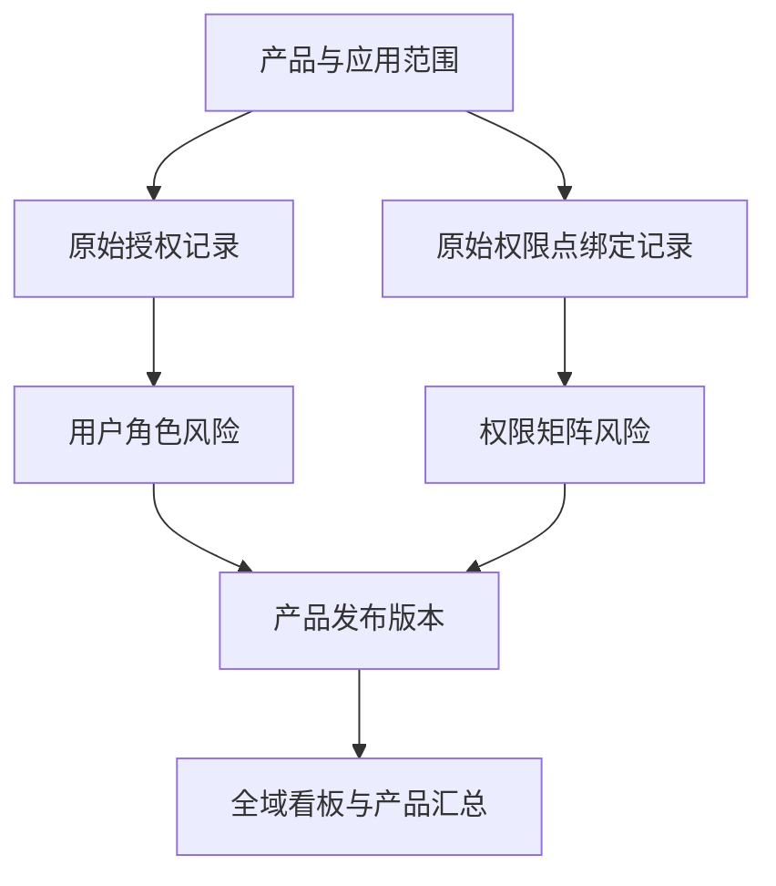
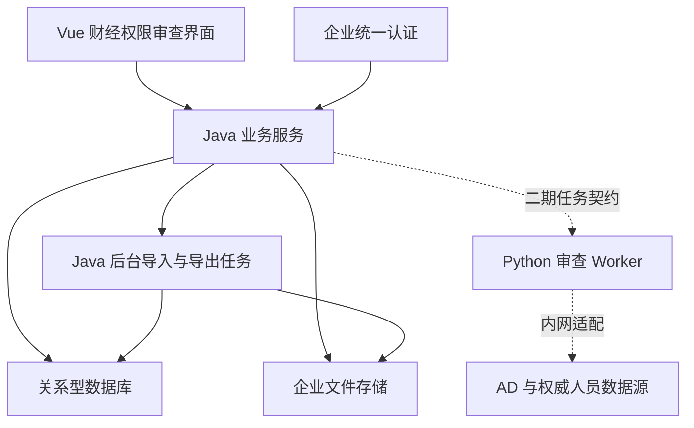
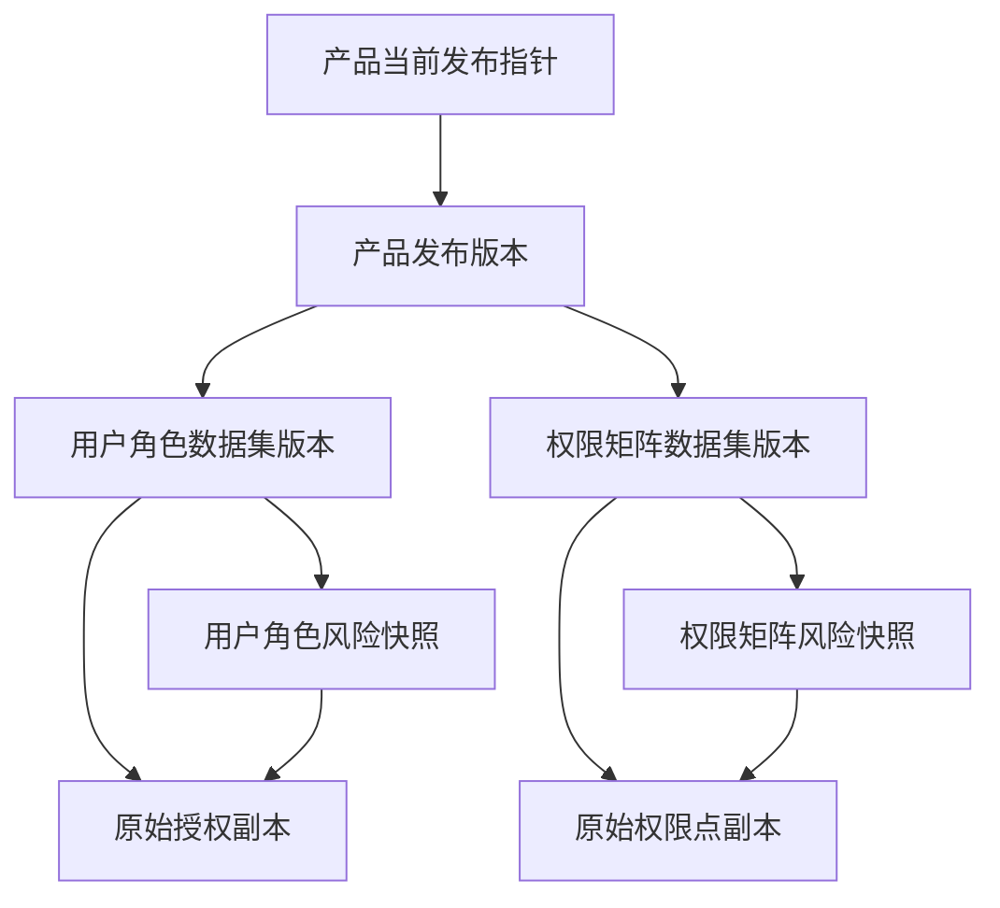
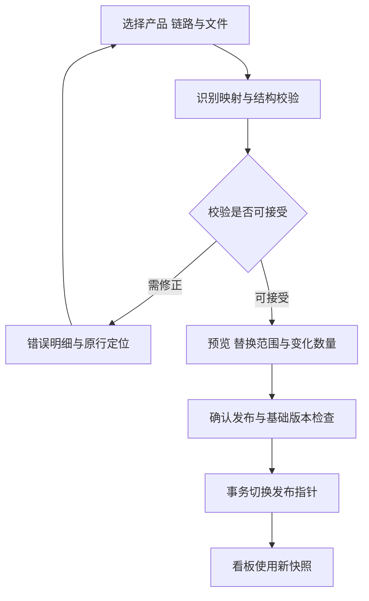

# 财经权限审查报告系统详细架构设计

一期结果管理与后续能力演进

版本 V1.1　修订日期 2026年10月19日（沿用原文件路径，当前架构基线以本文为准）

本系统面向领导、AA、产品和质量运营，提供财经权限风险的全域概览、按产品汇总、双类风险明细和原始数据追溯。建设以已认可的高保真页面和业务操作为基础，核心对象是授权记录、权限点记录和风险发现；Excel的Sheet用于兼容数据导入，不决定模块、服务或数据库的边界。

建议一期建设结果管理与发布能力，使用Vue前端、Java模块化单体、关系型数据库和企业现有文件存储。原有Skill继续在系统外完成审查，系统接收其结果与原始明细。后续通过稳定的结果契约接入Python审查执行、人员查询和整改复核，不要求一期先完成这些集成。

## 1 核心架构决策

| 编号 | 决策 | 具体含义 |
| --- | --- | --- |
| D01 | 以业务对象组织系统 | 保留高保真页面；Sheet名称属于导入映射，不创建同名业务模块。 |
| D02 | 建立两条核心追溯链路 | 用户—角色风险关联原始授权记录；矩阵风险关联原始角色—权限集—权限点记录。 |
| D03 | 一期独立于审查引擎交付 | 先支持上传、校验、结果修正、原始数据副本修改、发布和领导看板。 |
| D04 | 采用Java模块化单体 | 导入、结果、版本、看板、访问控制为同一应用内的模块；不预先拆微服务。 |
| D05 | 已发布版本不可原地覆盖 | 全量替换先形成草稿，校验后切换当前版本；旧版本与原文件保留。 |
| D06 | 编辑不等于生产整改 | 修改报告或原始数据副本，不自动操作iAuth，也不自动消除审查风险。 |
| D07 | 指标必须携带覆盖范围 | 无完整原始授权数据时，不从风险行反推授权总量或总用户数。 |
| D08 | 结果契约隔离脚本变化 | Python函数名、Excel布局、旧编号在适配层消化，不扩散到页面和核心模型。 |

本文中的字段、接口、状态和容量阈值是建议的设计基线。数据库产品、统一身份认证协议、实际数据规模与保留期限，应在企业现有标准内落实，不以新增中间件作为一期建设前提。

## 2 一期范围和分期路径

### 2.1 一期必须完成的业务结果

领导进入首页即可看到有来源、有时点、有覆盖说明的财经权限管理数据；按产品进入检查项汇总，再进入用户—角色风险或权限矩阵风险。AA、产品和质量运营可以按授权范围上传数据、查看校验错误、修正记录、追溯原始数据，并将确认后的版本发布到看板。

一期提供标准模板，同时兼容现有报告中的四类核心数据：风险记录明细、原始权限明细数据、权限矩阵检查结果、原始权限点明细数据。其余Sheet可忽略，也可作为来源统计与检查执行说明的补充输入，不作为上传成功的必要条件。

| 能力 | 一期 P1 | 二期 P2 | 三期 P3 |
| --- | --- | --- | --- |
| 全域与产品看板 | 已发布结果查询、数据时点、覆盖状态 | 周期对比和批次差异 | 持续监测与订阅 |
| 风险明细 | 两类明细、全部字段筛选、导出、原始记录下钻 | 自动新增与消失比对 | 跨应用组合分析 |
| 数据上传 | 标准模板与四类历史Sheet兼容 | 接收原始iAuth数据并发起审查 | 接口定期采集 |
| 数据修改 | 报告纠错、原始数据副本修订、修改原因、待复核 | 自动复核与人工确认结合 | 受控生产整改与回执 |
| 审查执行 | 继续由现有Skill在系统外完成 | Python Worker接入，结果经统一发布 | 规则配置和组织化运营 |
| 人员信息 | 使用上传字段，保留未知 | 内网AD及权威人员源适配 | 持续同步和失效刷新 |
| 部署依赖 | Java、数据库、文件存储、现有认证 | 增加Python执行环境 | 按实际压力选择调度与消息设施 |

### 2.2 一期明确暂不承担的能力

一期不承担自动收回生产权限、自动授权、HR事实认定和完整SOD组合冲突推理。它也不通过上传文件中的Python、宏或Excel公式执行审查。风险核实和数据修正是结果治理能力，尚不是生产权限变更闭环。

## 3 业务架构

### 3.1 核心业务对象

产品是领导查看和用户操作的数据范围；应用和租户描述授权的实际归属。原始授权记录表示某一账号在某一应用及租户下获得某一角色的事实。原始权限点记录表示角色、权限集和权限点的绑定事实，同一个权限点被不同角色绑定时是不同的审查对象。

风险发现表示某条规则对授权或绑定记录产生的审查结论。一条授权可命中多项规则，因此风险发现与授权记录是多对一关系。矩阵风险描述角色职责与权限点能力的冲突，不直接等同于某个用户已经实际执行了风险操作。



### 3.2 两条链路的责任边界

| 链路 | 原始对象 | 风险对象 | 下钻时必须回答 |
| --- | --- | --- | --- |
| 用户—角色 | 账号、应用、租户、角色、授权ID、有效期及人员分类 | 检查项1至7的命中记录 | 哪个人获得什么权限，哪条检查命中，依据哪个原始版本？ |
| 权限矩阵 | 应用、角色、权限集、权限点及资源类型的绑定 | 检查项8及8a至8f的冲突记录 | 哪个角色绑定了什么能力，分类和冲突依据是什么？ |

系统通过内部记录ID和版本ID建立关联，不把Excel内部超链接、行号或角色名称单独作为主键。来源文件、Sheet与行号保留为定位证据，便于人工回查。

### 3.3 产品与应用的归属

产品字典预置用户指定的18个产品。应用使用稳定ID和名称别名表；一个应用若确实服务多个产品，使用产品—应用关系维护归属，不通过名称相似度自动迁移数据。应用或租户缺失时保留“未提供”状态，不能把记录混入其他产品；缺失情况是否阻止发布由对应指标和关联要求决定。

上传时选定的产品和数据类型属于服务端约束。文件中携带其他产品的数据，须报告范围冲突，不能自动扩大本次替换范围。

## 4 总体技术架构

### 4.1 一期部署结构

Vue应用呈现已认可的页面，负责筛选交互、文件选择、校验预览与版本提示。Java服务承担认证授权、结构校验、数据关联、编辑、发布、统计和导出。数据库保存结构化记录、版本和操作留痕；企业文件存储保存原始上传文件、错误文件和导出文件。

一期通过数据库任务表和Java受控后台线程执行导入、校验及导出，不要求引入独立消息队列、Redis、搜索集群或工作流引擎。任务量增长后，可将后台任务独立部署，保持接口和业务模型不变。



### 4.2 Java模块划分

| 模块 | 核心职责 | 不承担的职责 |
| --- | --- | --- |
| Catalog | 产品、应用、租户、检查项目录及字段字典 | 不执行规则判断 |
| Ingestion | 文件识别、映射、校验、暂存、预览和错误定位 | 不直接替换已发布版本 |
| Review | 两类风险查询、原始记录关联、人工核实及修订 | 不直接变更生产权限 |
| Publication | 草稿、发布、替换、回退、并发检查 | 不在长事务内解析Excel |
| Dashboard | 发布版本上的指标、产品汇总和覆盖状态 | 不从风险记录推算总体人员规模 |
| AccessAudit | 产品范围、操作权限、下载鉴权及业务留痕 | 不另建一套雇员主数据 |
| Job | 导入、导出及后续审查任务的持久化状态 | 不把内存线程状态当作任务唯一记录 |

模块之间通过应用服务接口交互，不互相直接更新对方拥有的表。发布服务是当前版本指针的唯一写入入口，导入和编辑均须经过该入口生效。

### 4.3 技术选型原则

前端采用企业批准版本的Vue 3和现有财经组件库；状态管理、路由、表格、表单与上传沿用财经前端标准。Java采用企业批准的Spring体系和关系型数据访问组件；不在此阶段强行规定最新版本或重建已有平台能力。数据库优先复用现有支持事务、索引、备份和恢复的企业关系型数据库。

Excel解析采用企业已准入的Java组件，解析器位于导入适配层。文件存储优先使用现有对象存储；没有对象存储时可使用集中式受控文件存储，但多实例不能依赖各节点本地临时目录持久保存业务文件。

## 5 页面与权限架构

### 5.1 保持高保真设计的页面结构

| 页面 | 主要内容 | 主要动作 | 主要查询上下文 |
| --- | --- | --- | --- |
| 全域概览 | 授权、用户、风险、产品覆盖、风险分布、重点产品 | 产品下钻、报告导出 | 可见产品集合与发布快照 |
| 权限审查结果汇总 | 检查项、检查内容、检查结果、数量和风险等级 | 进入对应明细 | 产品与发布版本 |
| 权限审查结果明细 | 用户—角色和矩阵两个标签页 | 逐字段筛选、列设置、导出 | 产品、类型、规则、版本 |
| 原始数据侧栏或详情页 | 本轮判定依据、审查时原始记录、当前副本修订 | 修正报告、修改副本、查看历史 | 风险ID与原始记录版本 |
| 数据管理 | 模板、上传任务、错误预览、发布和历史版本 | 上传、确认替换、发布或回退 | 产品、链路、草稿与基础版本 |
| 规则说明 | 检查项、适用范围、版本和人工确认要求 | 查看说明 | 已发布结果所用规则版本 |

一期只补充必要的数据可用性、版本和待复核提示，不改变已经认可的视觉与操作主线。“授权明细”“权限矩阵明细”下钻由内部关联生成，不保存为可任意访问的外部URL。

### 5.2 角色和数据范围

| 动作 | 领导 | 产品成员 | 产品AA | 质量运营 | 平台管理员 |
| --- | --- | --- | --- | --- | --- |
| 查看授权范围内看板与明细 | 可 | 可 | 可 | 可 | 按明确授权 |
| 上传与校验草稿 | 否 | 可授权 | 可 | 可 | 默认不参与业务 |
| 修改报告及原始数据副本 | 否 | 可授权 | 可 | 可 | 默认不参与业务 |
| 确认风险或提出误报修正 | 否 | 可提交 | 可 | 可 | 否 |
| 发布或回退产品结果 | 否 | 否 | 按发布授权 | 按发布授权 | 否 |
| 维护产品范围和访问配置 | 否 | 否 | 本产品有限配置 | 运营范围 | 可 |

以上为建议默认分工，角色名称和发布权限复用现有权限体系。是否要求修改人与发布人分离，由企业治理要求确定；一期不因此引入通用审批引擎。平台技术管理身份不自动获得财经明细和导出权限。

后端对每次读取、编辑、上传、发布和下载验证产品范围。前端隐藏按钮只改善体验，不作为鉴权依据。跨产品看板、搜索、筛选值和导出也使用同一数据范围，防止通过统计或下拉选项越权获取信息。

## 6 核心数据模型

### 6.1 数据分层

系统保存三种不同性质的数据：上传文件是不可变来源证据；标准化原始记录和风险发现是业务数据；汇总与看板是可重建的查询结果。脚本的“数据概况”“整改建议”等Sheet不各建一套重复业务事实，而是映射到来源元数据、风险字段或查询投影。

| 逻辑实体 | 关键字段 | 约束和用途 |
| --- | --- | --- |
| Product | product_id、code、name、enabled | 产品稳定编码，18个初始产品 |
| Application | app_id、source_system、external_app_id、name | 以来源和外部ID识别，不以显示名称识别 |
| ProductApplication | product_id、app_id、tenant_scope | 维护允许的归属和授权范围 |
| FileAsset | asset_id、digest、size、storage_key、creator | 原文件只读，下载重新鉴权 |
| ImportJob | job_id、product_id、kind、base_release_id、status | 上传与校验任务，记录幂等键和错误统计 |
| ReviewDataset | dataset_id、product_id、kind、version、coverage | 一条链路的一版原始数据及结果集合 |
| AuthorizationRecord | row_id、dataset_id、source_key、业务字段 | 原始授权副本，关联账号和角色 |
| PermissionPointRecord | row_id、dataset_id、binding_key、业务字段 | 角色—权限集—权限点绑定，不是权限点主数据 |
| RiskFinding | finding_id、dataset_id、rule_code、severity、review_status | 两类风险共用的身份、结论和状态 |
| UserRoleFinding | finding_id、用户与授权审查快照字段 | 风险发生时看到的字段，不被源副本修改覆盖 |
| MatrixFinding | finding_id、角色与权限点审查快照字段 | 矩阵结论、置信度和判定依据 |
| ChangeRecord | change_id、draft_id、target_id、before、after、reason | 区分报告修正与原始副本修订 |
| ProductRelease | release_id、product_id、两类dataset_id、version | 不可变发布清单，允许另一链路沿用旧版 |
| ProductPublication | product_id、current_release_id、lock_version | 每产品唯一当前版本，事务切换 |
| DashboardSnapshot | snapshot_id、release_vector、scope、metrics | 固定本次看板使用的产品版本集合 |
| AuditEvent | event_id、actor、action、scope、version、time | 业务操作日志，发布与主事务一致保存 |

这些是逻辑表边界，不代表必须部署相应数量的服务。两类风险使用公共主表加类型明细表，避免把所有字段塞入一个无类型JSON列，也避免复制发布、权限和状态逻辑。

### 6.2 版本关系

产品发布版本引用用户—角色数据集版本与矩阵数据集版本，两个版本可以分别更新。发布一类数据时，另一类版本保持不变；页面同时展示两类数据各自的来源时点，不能把较老的数据伪装成本轮已经更新。



### 6.3 原始关联与业务主键

用户风险优先按来源系统、应用、租户和授权ID关联原始授权。授权ID缺失时，使用用户标识、角色ID或角色名称、应用、租户及必要的生效信息生成候选关联，只有唯一匹配时才能建立确定关联。无法匹配或存在多条候选时仍可导入风险，但标记“未关联”或“关联待确认”，不跳转到任意一条记录。

矩阵风险优先使用应用、租户、角色ID、权限集ID和权限点ID识别绑定。历史文件缺少角色ID或权限集ID时，可使用明确范围内的名称作为兼容键，并保留其关联可信度。同名角色、同名权限集不能跨应用合并。

每条风险保留 audited_source_row_id 指向审查时的不可变记录；当前副本使用 current_source_row_id 指向最新发布副本。源数据发生修订时，两者可不同，界面分别显示“审查时数据”和“当前副本”。

### 6.4 一期草稿实现

一期采用容易验证的实现：为受影响链路创建新草稿数据集，原始记录与风险从基础版本复制或导入到暂存区；在同一草稿上完成多次编辑，最终一次发布。不要每改一个字段就复制整个产品，也不要直接更新当前已发布数据。

在实测表明完整复制成为容量瓶颈后，再引入不可变行版本复用和成员索引，不在一期预先实现复杂的差量存储框架。逻辑上的记录身份、版本引用和变更记录必须保留，使该优化不会改变对外契约。

## 7 数据契约和完整性

### 7.1 数据集元信息

| 字段 | 含义 | 一期要求 |
| --- | --- | --- |
| product_id、dataset_kind | 产品和USER_ROLE或MATRIX链路 | 必填，由服务端绑定 |
| origin、template_version | 标准模板、旧报告、人工修订或后续引擎 | 必填，识别结果可人工确认 |
| source_as_of、report_generated_at | 源数据时点和报告生成时间 | 可未知，但不能用上传时间冒充 |
| raw_coverage | FULL、PARTIAL、NONE、UNKNOWN | 必填，不根据文件存在自行认定FULL |
| finding_coverage | FULL、PARTIAL、NONE、UNKNOWN | 必填，表示风险清单覆盖范围 |
| executed_rules | 已执行检查项与执行状态 | 可不提供；缺少时不生成检查通过结论 |
| rule_version、engine_digest | 规则版本和后续引擎构件摘要 | 已知则保存，未知保留UNKNOWN |
| expected_raw_count | 声明的全量原始记录数 | 可选；有值时须与解析结果核对 |
| input_rows、accepted_rows、rejected_rows | 输入、接受和拒绝行数 | 必须记录并满足对账关系 |
| source_assets、source_location | 原文件、Sheet、原始行号 | 必须可追溯 |

### 7.2 支持的上传方式

| 模式 | 输入 | 可立即提供的能力 | 必须明确的限制 |
| --- | --- | --- | --- |
| 用户角色结果包 | 风险明细与原始授权，可在同一文件或配对文件 | 用户风险、授权下钻、在覆盖完整时统计总体规模 | 两份数据的范围和时点须一致或明确差异 |
| 矩阵结果包 | 矩阵检查结果与原始权限点，可在同一文件或配对文件 | 矩阵风险及原始绑定下钻 | 角色与绑定的应用范围必须明确 |
| 仅风险结果 | 任一类风险明细 | 风险数量、风险筛选和结果修正 | 不生成总体授权数或总体用户数，不保证原始关联 |
| 仅原始数据 | 任一类原始记录 | 原始数据查询与相应规模统计 | 不代表已经审查，不由空风险表推导通过 |

仅上传风险时允许引用历史原始数据作为单独的统计基线，但须明确其时点，不自动认定这些原始数据就是本次风险的审查依据。只有范围与基线得到明确验证后，才能建立审查证据关联。

### 7.3 空清单与部分数据

有表头、无风险行不一定是错误。用户声明上传的是完整风险清单，并确认“替换为0条”时，可以按所选产品和类型清空当前风险清单，保留历史版本；必须把该动作作为明确的替换操作展示。它仍不自动证明所有检查项均已执行并通过。

缺少原始Sheet、只上传部分应用、历史报告原始明细被截断或来源范围不清时，可以发布为“部分数据”供领导使用，但相关总体指标显示已覆盖范围或“未提供”，不能显示成全产品精确总量。上传校验错误行默认不自动丢弃后发布；用户须修正，或明确选择部分发布并保留拒绝行统计。

## 8 导入校验和原子发布

### 8.1 导入流程



上传与解析先于发布完成，期间领导始终读取原已发布版本。标准模板直接映射到稳定业务字段；历史文件由专用适配器识别四类核心Sheet。一个文件同时包含两条链路时，先组成同一发布候选；用户确认后一起生效，避免只导入成功一半。

### 8.2 校验层级

| 层级 | 检查内容 | 处理方式 |
| --- | --- | --- |
| 文件 | 扩展名与内容类型、大小、加密、压缩膨胀、宏及外链 | 不支持的格式拒绝；不执行公式和宏 |
| 结构 | Sheet或字段特征、必填列、重复表头、类型、真实非空行 | 返回文件、Sheet、行列定位 |
| 范围 | 所选产品、应用、租户、数据类型与文件一致性 | 越界数据阻止发布 |
| 记录 | 编号、工号文本、日期、风险等级、置信度、字段长度 | 保留原值和标准化值，错误可下载 |
| 唯一性 | 授权强键、绑定强键、风险与规则组合 | 冲突键不静默合并；精确重复须明确去重策略 |
| 关联 | 风险到原始记录的一对一候选、无匹配、多匹配 | 可保留未关联风险，但限制下钻与副本修改 |
| 对账 | 接受行数、完整性声明、期望数量及可选汇总一致性 | 明确数量差异，避免静默截断 |

日期同时支持文本日期和Excel日期单元格，统一存储为明确时区的日期或时间。工号、部门编码、授权ID、权限点ID按字符串处理，不能转成数值后丢失前导0。置信度接受0至1或百分数，并记录其来源和方法；不在导入时重新假造置信度。

### 8.3 替换粒度

默认替换粒度为“产品 + 链路 + 所选数据对象”。上传用户—角色风险不影响矩阵结果，也不影响其他产品；上传风险明细不隐式删除原始授权。配对包中的原始数据和风险结果作为一组同时替换，避免新的风险指向已经被物理删除的旧数据。

预览必须显示当前产品、链路、来源时点、旧记录数、新记录数、新增/减少/未关联数量、完整性及关联风险。未选择的数据对象保留原版本。历史缺失的风险仅标记“本次清单未出现”，不能据此自动认定已完成整改。

### 8.4 发布事务和并发

每个草稿固定 base_release_id。用户确认后，Java在短事务中验证发布权限、校验状态和基础版本，写入新的ProductRelease、更新ProductPublication指针并记录AuditEvent。看板聚合在指针切换前准备完成或随同落库；未准备好时继续读旧版，不能读取一半新数据。

发布采用数据库行锁或条件更新保证同一产品的切换串行。若当前版本已变化，返回版本冲突，要求重新预览；一期不自动合并相互覆盖的数据。编辑接口采用记录版本和If-Match防止多人覆盖，语义与RFC 9110条件请求一致。[W2]

文件上传不放进数据库长事务。文件先处于暂存状态，结构化校验通过后才被发布记录引用；失败文件按暂存清理规则回收。发布重试使用幂等键：同一操作者、范围、请求键与相同请求摘要返回原结果；同键不同内容须拒绝。

### 8.5 任务恢复

任务表保存阶段、进度、心跳、重试次数和租约。进程重启后可重新领取租约过期的任务，从已完成的解析或校验阶段继续，或安全重做暂存阶段。发布完成后重复执行不能创建额外生效版本。

解析失败或发布失败不改变当前看板。回退通过创建一个引用旧数据集的新发布版本完成，并记录原因，不删除中间版本，也不把历史时间改写为当前源数据时间。

### 8.6 任务与草稿状态

| 对象状态 | 允许的后续动作 | 对当前看板的影响 |
| --- | --- | --- |
| RECEIVED或PARSING | 解析、取消、失败后重试 | 无影响 |
| VALIDATING | 结构、范围、关联及数量校验 | 无影响 |
| VALIDATION_FAILED | 下载错误、重新映射或重新上传 | 无影响，不允许发布 |
| READY_TO_PUBLISH | 预览、修改声明、确认发布 | 无影响 |
| PUBLISHING | 成功、冲突退回重新预览或失败重试 | 事务完成前仍使用旧版 |
| PUBLISHED | 查看、导出、基于其创建新草稿或回退 | 新发布指针生效 |
| CANCELLED或FAILED | 说明原因，按允许阶段恢复或重建任务 | 无影响 |

编辑草稿与导入任务分别保存状态。草稿从DRAFT经校验进入VALIDATED，再发布为不可变版本；放弃草稿不影响已发布数据。产品当前版本改变后，旧基础草稿标记STALE，需要重新基于当前版本确认，不能直接继续覆盖。

## 9 数据修改和风险核实

### 9.1 区分两种修改

| 修改类型 | 可修改内容 | 生效后的含义 |
| --- | --- | --- |
| 报告结果修正 | 风险说明、整改建议、责任说明、经核实的误报标记及必要的等级修正 | 形成新发布结果；保留导入原值、修正人、原因和前后差异 |
| 原始数据副本修订 | 原始授权或权限点绑定中的业务字段 | 当前副本已更新，关联风险进入待复核；不改变生产iAuth权限 |

检查项编号、产品、对象类型、内部记录ID和审查来源版本不允许通过普通字段编辑直接迁移。需要更正归属或撤销错误记录时，使用明确的更正动作，保留原记录及撤销原因，不进行无痕删除。

### 9.2 副本修订后的处理

用户在原始数据页修改字段并填写原因，系统创建或更新该产品链路的草稿，识别所有关联风险并标记“待复核”。修改授权有效期不会自动判定检查项6通过；修改角色名称或权限点描述也不会自动判定矩阵冲突消失。

发布后，领导仍能看到相关风险及待复核数量。详情同时展示审查时原值、当前副本和修改记录。二期自动审查接入后，可以对受影响对象重新执行规则，再通过正式结果发布改变结论。

### 9.3 一期核实状态

| 状态 | 进入条件 | 是否计入当前有效风险 |
| --- | --- | --- |
| 待核实 UNREVIEWED | 首次导入尚未完成业务核实 | 计入 |
| 已确认 CONFIRMED | 授权人员确认风险成立 | 计入 |
| 误报 FALSE_POSITIVE | 授权人员给出明确理由并发布修正 | 不计入当前有效风险，原始命中仍保留 |
| 待复核 NEEDS_RECHECK | 原始副本发生影响判定的修改，或证据需重新确认 | 计入，单独提示 |

一期不默认提供“点击完成即关闭风险”的按钮。后续正式复核或外部完整审查结果可以提供关闭依据；仅修改描述、上传新清单或找不到旧行，不构成风险关闭证据。

### 9.4 编辑与发布的一致性

修改界面提交 expected_record_version 和变更原因。服务端校验字段白名单、业务范围、格式及基础版本；一条原始授权关联多条风险时，统一产生受影响记录列表。草稿发布前重新计算指标，避免看板数量与明细数量不一致。

没有确定关联的风险允许修正报告结果，但不能通过“原始数据编辑”修改某个猜测对象；界面应显示未关联原因，并允许上传或补充关联信息。强键字段变更会触发重新关联与冲突校验，不能静默改写原审查证据。

## 10 看板指标与检查结果口径

### 10.1 指标字典

| 指标 | 计算口径 | 数据不足时的展示 |
| --- | --- | --- |
| 授权记录数 | 当前发布且范围完整的原始授权有效记录数；不把矩阵绑定行计入 | 部分覆盖时显示覆盖范围；没有原始数据时未提供 |
| 总用户数 | 对可见原始授权中的统一用户键去重；不能把各产品用户数相加 | 身份口径不统一时标注按账号去重或显示未关联账号量 |
| 云山用户数 | 按已确认的审查人员分类统计云山IT用户 | 分类不明的记录进入待确认，不强行归入业务 |
| 业务雇员数 | 业务人员且雇员标记为是的去重用户数 | 标记缺失时不计入已知分类 |
| 业务非雇员数 | 业务人员且雇员标记为否的去重用户数 | 同上，保留未知人数 |
| 其他及待确认人数 | 质量与流程IT、系统账号、未知类别及未归一身份按规则单列 | 在用户统计的说明或展开项中展示 |
| 原始命中记录数 | 导入或正式审查产生的风险发现记录数，按检查项计数 | 部分清单标注结果覆盖范围 |
| 当前有效风险数 | 原始命中与正式补录，扣除已确认误报和明确撤销的重复记录 | 原始副本修改和待复核仍计入 |
| 高中低风险数 | 当前有效风险按已发布有效等级分组 | 默认等级和人工修正均可追溯 |
| 已提供产品数 | 当前拥有至少一类已发布数据的产品数 | 不等同于完整完成全部审查的产品数 |
| 完整审查覆盖 | 范围、必需数据和检查执行说明均满足要求的产品或规则数 | 不把仅上传成功视为审查完成 |

高保真页面的“权限风险记录”默认承接当前有效风险数，原始命中数、误报修正数和待复核数在说明及下钻中可见。每一个可点击的数量必须使用与明细相同的过滤条件和版本上下文。

### 10.2 用户去重与分类

保存原工号、规范化账号和统一用户键三个字段。规范化只进行经过确认的大小写、空白及来源格式处理。用于“是否雇员”判断的补00规则不能直接用来建立跨系统人员主键，也不能仅凭名字相同合并用户。

一期优先要求模板提供稳定的用户标识及其命名空间；现有工号一致的数据按约定口径去重。W3账号、纯数字工号与系统账号混合时，使用明确的身份映射，不能自行推测两个账号属于同一人。同一用户在多个来源出现互斥分类时，标记分类冲突，不随意取第一条。

“是否云山组织”“审查人员类别”“是否雇员”“是否集团财经”是独立维度。建议看板的三类主要人数使用审查人员分类口径，质量与流程IT和未知类别放入其他及待确认，保证总数可对账。最终云山口径须由业务Owner确认后写入指标版本。

### 10.3 检查执行与结论分别保存

检查执行状态为已执行、未提供、未执行、不适用或失败；检查结论为通过、发现风险、需人工确认或数据不足。风险记录上的人工核实状态则使用第9章的独立枚举。三个维度不得挤进一个“状态”字段。

存在风险记录即可说明该项有命中；没有风险记录只能说明当前清单未检出记录。只有完整覆盖范围、检查执行说明及足够数据同时具备时，才允许显示“通过”。对历史结果保留来源结论，同时可以显示其证据完整性，避免重写外部报告的原意。

一期汇总页的检查项由稳定目录和已发布风险聚合得到，不依赖必须上传“合规检查结果汇总”Sheet。若上传文件包含该Sheet，可作为执行说明的来源，在校验后映射到独立执行元数据。

### 10.4 快照时点与实时含义

分别记录源数据截至时间、审查生成时间、上传时间和发布时间。首页“实时”指已发布结果可及时刷新，不代表生产权限正在实时采集。新版本发布后，页面通过轻量轮询或版本检查发现变化，提示刷新或整体切换到新快照。

一次看板读取固定产品发布版本集合，返回 snapshot_id。产品汇总、风险数量和明细下钻沿用该上下文；期间有新发布时，不把旧数量和新明细混在一起。跨产品源数据时点不同应显示范围或最新/最旧时点，避免伪装成同一时刻的全域盘点。

服务端在一次可重复读或等价的一致性读取中取得可见产品的发布指针，形成快照清单。全域指标也必须按服务端授权范围计算，不能把全公司的明细或总量下发后再依靠浏览器过滤。

## 11 接口设计

### 11.1 读接口

接口统一以 /api/v1 为前缀，示例路径是契约设计，不绑定具体Controller名称。服务器返回操作者可见的产品范围，不接受客户端自报的越权范围。

| 方法与路径 | 核心参数 | 返回与约束 |
| --- | --- | --- |
| GET /products | enabled、查询关键词 | 允许访问的产品和数据可用状态 |
| GET /dashboard | snapshot_id、产品过滤 | 指标、产品列表、版本上下文和覆盖说明 |
| GET /products/{id}/review-summary | release_id | 稳定检查项、数量、执行状态、结论和版本 |
| POST /findings/search | product_ids、kind、filters、sort、page、snapshot_id | 两类明细分页；所有数据字段可筛选 |
| GET /findings/{id} | release_id | 原导入结果、有效修正、审查证据和关联状态 |
| GET /source-records/{id} | record_kind、release_id | 审查时记录与当前副本及允许动作 |
| GET /products/{id}/releases | kind、分页 | 历史版本、时点、发布人和变化摘要 |
| GET /templates/{kind} | template_version | 对应标准模板和填写说明 |

### 11.2 写入和长任务接口

| 方法与路径 | 核心输入 | 成功结果 |
| --- | --- | --- |
| POST /import-jobs | 产品、链路、对象类型、文件、基础版本 | 202与任务ID，不直接发布 |
| POST /import-jobs/{id}/validate | 字段映射、来源范围、完整性声明 | 校验任务状态 |
| GET /import-jobs/{id} | 任务ID | 阶段、进度、错误数、预览摘要 |
| GET /import-jobs/{id}/errors | 分页或错误文件请求 | 行列定位错误，受产品范围控制 |
| POST /import-jobs/{id}/publish | 预览令牌、替换范围、base_release_id、幂等键 | 新release_id和变化摘要 |
| POST /products/{id}/drafts | base_release_id、影响链路 | 编辑草稿ID |
| PATCH /drafts/{id}/findings/{findingId} | 字段变更、原因、记录版本 | 新草稿版本及差异 |
| PATCH /drafts/{id}/source-records/{rowId} | 副本变更、原因、记录版本 | 受影响风险列表及待复核提示 |
| POST /drafts/{id}/publish | base_release_id、If-Match、原因 | 新发布版本与指标 |
| POST /products/{id}/rollback | target_release_id、基础版本、原因 | 新发布版本，引用目标数据 |
| POST /export-jobs | 同查询过滤、字段、snapshot_id | 202与导出任务ID |

### 11.3 筛选契约

filters以字段编码、操作符和值的数组表达。文本字段支持等于、包含及集合；等级和状态使用受控枚举；日期和数值支持区间。服务端维护字段编码到数据库列的白名单，不能拼接客户端提供的列名、排序表达式或SQL片段。

默认关键字段与“全部字段”使用同一查询数据源，隐藏字段不会消失；表头筛选、全局条件和导出采用同一筛选模型。总数、当前页和导出结果都绑定同一快照，分页排序必须添加稳定记录ID作为最终排序键。

### 11.4 返回示例

```json
{
  "snapshotId": "snapshot-opaque-id",
  "releaseId": "release-opaque-id",
  "sourceAsOf": "2026-10-16T18:30:00+08:00",
  "coverage": {"raw": "FULL", "findings": "FULL"},
  "metrics": {
    "authorizationRecords": {"value": 1000, "quality": "COMPLETE"},
    "effectiveRiskRecords": {"value": 12, "quality": "COMPLETE"},
    "needsRecheck": 2
  },
  "availableActions": ["VIEW", "EXPORT"]
}
```

示例数量仅用于说明接口，不代表实际业务数据。数据未提供时value返回null并给出原因，不能返回0伪装为已统计。availableActions用于页面展示，服务端仍须逐次鉴权。

### 11.5 错误和并发约定

401表示未认证，403表示没有操作或数据范围权限，404不泄漏无权访问对象是否存在，409表示发布范围或幂等请求冲突，412表示If-Match或基础版本已变化，422表示结构或业务字段校验失败。缺少强制版本条件时可使用428并说明如何重新获取版本。

错误响应包含code、message、request_id及可选字段或原行定位。对于已创建的异步任务，业务失败通过任务FAILED状态和详细错误返回，不以HTTP连接断开代表失败。上传、发布和导出都不得因客户端重复点击而重复生效。

## 12 前端与后端内部设计

### 12.1 Vue模块结构

页面按Overview、ProductSummary、RiskExplorer、SourceDetail、DataManagement与RuleCatalog组织。共用组件包括指标卡、产品选择、版本提示、两类字段字典、受控筛选、导入预览、修改差异和发布确认。

前端状态分为查询上下文、交互状态和服务端草稿：查询上下文包含产品、链路、规则、快照与过滤条件，可写入URL方便回到原位置；弹窗与列显示偏好属于交互状态；业务草稿和上传结果保存于后端。生产系统不使用localStorage作为风险数据和权限判定的事实库。

原始数据侧栏先显示风险依据，再显示审查时数据和当前副本。关联缺失、数据部分覆盖、当前版本已变化、文件校验失败、发布中及无数据均提供明确状态。数据不足不使用绿色通过标签。

### 12.2 Java应用服务

应用层负责用例编排，例如ImportApplicationService、ReviewApplicationService、PublicationService和DashboardQueryService。领域层维护范围、版本、风险状态和指标规则；基础设施层负责Excel适配、持久化、文件访问与后续外部接口。

Excel结构只存在于LegacyReportAdapter和StandardTemplateAdapter中。查询服务接收稳定字段编码，不了解“第几个Sheet”“第几列”。后续Python执行结果通过AuditResultAdapter转换为同一领域对象，不让页面直接读取Python导出的Excel。

### 12.3 事务和一致性边界

草稿编辑以单条记录或一个明确的关联变更为事务；发布以一个产品的新发布清单和当前指针为事务。导入解析、Excel生成、AD查询和远程审查执行均在数据库事务之外完成。Spring支持声明式本地事务，但不会自动替代跨远程调用的一致性设计。[W1]

导入完成后，在暂存数据上计算校验摘要和看板聚合；发布事务只做最终权限、版本及摘要验证和指针切换。审计事件与发布记录同时提交，防止“数据已生效但没有发布记录”。文件回收和可重建缓存允许最终一致，不影响业务版本正确性。

## 13 索引与性能设计

| 查询或操作 | 建议索引或限制 | 说明 |
| --- | --- | --- |
| 当前产品版本 | ProductPublication主键product_id | 当前指针唯一 |
| 产品风险列表 | dataset_id、kind、severity、review_status、finding_id | 适配默认分页和风险筛选 |
| 按规则汇总 | dataset_id、rule_code、severity | 覆盖检查项汇总 |
| 用户与授权定位 | dataset_id、user_key；范围化auth_id | 不把授权ID假设为全公司全局唯一 |
| 矩阵绑定定位 | dataset_id、app_id、role_key、point_id | 同权限点的多角色绑定分别保留 |
| 修改与历史追溯 | target_id、created_at；base_release_id | 查看差异与重建证据链 |
| 任务领取与恢复 | status、lease_until、created_at | 一期使用数据库租约调度 |

所有字段可筛选不意味着为每个字段都建单列索引。先覆盖常用筛选与组合索引，长文本包含查询限定产品、版本和结果范围，设置查询超时；确有压力后再评估数据库全文索引或搜索服务。

以下为一期建议压测基线，不是未经验证的性能承诺：单次原始记录10万行、风险记录2万行、文件50MB、20个并发查询用户；分页20至100条，导出超过单次交互规模转后台任务。默认列表P95目标2秒，看板P95目标3秒，发布完成后的版本可见性目标10秒内。实际阈值须用代表性文件和企业部署资源验证。

Excel格式损坏造成百万空行时，解析应基于真实非空数据和合理边界处理，不能仅凭max_row推断真实数据量，也不能为了性能直接跳过存在有效数据的大Sheet。任何截断都必须在覆盖元信息和预览中明确展示。

## 14 部署运行与数据保护

### 14.1 部署方式

一期使用现有网关和统一认证入口，Vue静态资源按财经前端标准部署；Java服务至少区分查询请求池与后台任务池，避免一次大文件导入耗尽看板查询线程。正式环境实例数与数据库高可用方式复用企业标准，不为本项目另造一套基础平台。

文件对象与结构化数据保留关联摘要。数据库备份、原文件备份与恢复演练要能恢复到同一发布版本，不能只恢复指标而丢失对应明细或来源文件。业务记录保留期限、归档与删除策略由数据Owner和企业现有制度确定。

### 14.2 业务数据保护

身份认证复用现有企业身份能力，业务访问按角色和产品范围控制。下载原文件、导出全部字段和修改原始副本是独立动作权限。敏感人员字段在列表、详情、日志和导出中使用一致的授权策略，业务日志不打印完整上传内容。

导入文件只作为数据处理，限制路径、压缩膨胀、异常格式与字段长度；不执行上传脚本、宏或公式。原始文件只读，解析后的规范化数据允许受控修订，保留前后差异。共享下载不能使用永久公开文件链接。

### 14.3 运维可观测性

任务日志通过request_id、job_id、product_id、dataset_id和release_id串联。监测导入失败率、解析耗时、关联缺失率、数据覆盖、未更新产品、发布冲突、待复核数量、导出排队时长和存储增长。角色越权和发布失败使用可定位事件，避免只看到“系统错误”。

业务留痕至少覆盖上传、映射确认、校验、编辑、误报确认、发布、回退和敏感导出。每条记录包含操作者、产品范围、来源版本、目标版本、原因和时间；批量操作要有摘要与可追溯的明细范围。

## 15 后续审查引擎与人员查询接入

### 15.1 二期复用路径

二期新增审查任务，输入为指定原始数据集版本和规则构件版本。Java负责创建任务和发布结果，Python Worker负责读取固定输入、执行规则并输出结构化结果；Worker输出与手工上传共用同一校验、关联、预览和发布通道。

优先封装现有脚本而非立即重写全部规则。可先保留Excel输入输出，在适配器中转换；随后增加JSON结果契约并将Excel作为可选报告产物。Python Worker与Java分进程运行，不在HTTP请求线程中调用长时间审查，不允许调用者传入任意脚本路径或命令。

一次审查固定输入文件摘要、原始数据版本、规则版本、标签分类版本、组织字典版本和人员信息时点。超时、取消、失败、跳过和数据不足均返回明确状态，不能把空列表视为执行成功且全部通过。

### 15.2 人员信息适配

人员数据服务返回组织层级、账号启停、雇佣状态、查询状态、来源和时点，不混为一个is_valid布尔值。AD的ACCOUNTDISABLE说明账号被禁用；据此不能直接证明劳动或雇佣关系已经终止，这是基于该属性定义作出的架构判断。[W3]

employee_lookup当前包装依赖employee-info-query及用户说明中的ADSI查询方式。后续应在企业内网适配器中验证实际运行平台、认证方式和账号查询覆盖；未取得employee_query实现前不假设其可直接在Linux服务端运行。纯数字工号和非标准账号无法直接转为sAMAccountName时应返回IDENTIFIER_UNRESOLVED，不当作离职。

查不到、请求失败、账号禁用、在职和离职分别建模。人员分类优先使用明确的部门编码及版本化组织规则；人员信息刷新后重新计算完整的派生分类，不只更新其中一个is_it字段。查询结果按来源和时点缓存，缓存策略不改变审查批次所固定的证据版本。

### 15.3 整改闭环的后续边界

三期如接入真实iAuth整改，应新增受控变更申请、审批、执行回执和复核，而不是复用“编辑原始副本”接口直接写回生产。影子副本修订、整改请求和生产事实是三种对象，必须保持各自来源与状态。

## 16 分阶段交付与验收

### 16.1 一期内部交付顺序

| 增量 | 建设内容 | 可验收结果 |
| --- | --- | --- |
| P1A 可见 | 产品字典、四类核心数据导入、关联、基础看板与双明细 | 一个产品的真实脱敏报告可完整走通看板和两条下钻链路 |
| P1B 可修 | 草稿、报告修正、原始副本修改、待复核、完整筛选和导出 | 修改前后可比较，关联风险保留，数量与明细一致 |
| P1C 可发布 | 产品访问范围、版本并发、全量替换、回退、审计和运行保障 | 多产品多人操作不越权、不覆盖、不半量生效 |

P1A可用于受控试用；面向正式领导看板发布前，应完成P1C所列的数据范围、版本和原子发布保障。不要把这些保障整体留到自动审查接入后再补。

### 16.2 关键验收用例

| 编号 | 场景 | 预期 |
| --- | --- | --- |
| A01 | 同时导入四类核心Sheet，含其他辅助Sheet | 正确识别两条链路，辅助Sheet不改变业务模型 |
| A02 | 只上传风险明细 | 风险可查；授权量和用户量不伪造；原始关联状态明确 |
| A03 | 完整原始授权中同一用户跨产品出现 | 总用户按统一键去重，不求各产品人数之和 |
| A04 | 同一授权命中多项检查 | 风险按检查项分别计数，原始授权不重复计为多条 |
| A05 | 同名角色分属两个应用 | 各自关联正确，不按角色名称串错 |
| A06 | 修改一条原始授权有效期 | 所有关联风险待复核；原审查证据可回看 |
| A07 | 修正误报并发布 | 当前有效风险和明细同步变化；导入原命中仍保留 |
| A08 | 对某产品替换用户角色风险 | 不影响其他产品与矩阵结果，也不误删原始记录 |
| A09 | 明确声明完整的0条风险清单 | 可确认替换为0条，仍不无依据声明全部检查通过 |
| A10 | 校验失败、断网或进程重启 | 当前看板保持旧版，任务可恢复或重试 |
| A11 | 两人基于同一版本发布 | 第一个生效，第二个收到冲突并重新预览 |
| A12 | 数据部分覆盖或原始文件截断 | 覆盖提示明确，不显示虚假的完整总体统计 |
| A13 | 无权用户构造产品ID或导出请求 | 查询、修改、下载、导出均拒绝且可追溯 |
| A14 | 发布后立即从指标下钻 | 数量、筛选、明细和导出使用同一版本 |
| A15 | 回退到历史结果 | 形成新的发布记录，旧版本仍在，来源时点不改写 |

### 16.3 二期接入门槛

自动审查接入前，需完成规则口径核定、脱敏回归样本集、规则版本锁定、未知与失败状态契约，以及人员适配的运行验证。实际规则差异和质量问题不阻塞一期报告管理上线，但不得未经核定直接变成自动生产审查结论。

## 17 待确认事项与默认方案

以下事项影响最终配置，但不阻止架构评审和一期设计继续进行。默认方案均为建议，不代表已获得企业系统接入或数据政策确认。

| 事项 | 建议默认方案 | 确认责任 |
| --- | --- | --- |
| 发布权归属 | 产品AA或质量运营获得产品范围内发布权 | 业务Owner |
| 数据修改边界 | 一期仅修改系统内报告和原始副本 | 业务Owner与iAuth Owner |
| 云山人数定义 | 使用审查人员分类口径，其他与未知单列 | 财经权限治理Owner |
| 全量替换范围 | 产品、链路、所选对象三者共同约束 | 产品AA |
| 应用和租户主数据 | 复用已有ID，名称只作显示与兼容 | 应用架构与产品 |
| 数据库与文件存储 | 复用企业已有服务，不增加部署类别 | IT平台 |
| 认证协议与角色来源 | 复用现有财经登录及产品数据范围 | IAM与平台Owner |
| 数据规模与保留期限 | 用代表性脱敏文件压测，按企业制度定期归档 | 数据Owner与运维 |
| 旧报告统计不足 | 原始授权为主要统计来源，不强制补齐全部辅助Sheet | 产品AA |
| 检查项8e和人员特殊分类 | 作为二期规则核定事项，不在一期擅自修正 | 规则Owner |

## 附录A 四类核心数据字段

### A1 用户角色风险

| 页面字段 | 业务含义 | 存储与关联要求 |
| --- | --- | --- |
| 检查项、检查项名称 | 稳定规则编码及显示名称 | 编码映射到规则目录，保留来源原值 |
| 用户工号、用户名称、用户部门 | 审查时人员信息 | 均保留快照，工号按文本 |
| 权限名称、角色类型、权限类型 | 授权角色和权限分类 | 优先使用角色ID；缺失时保留范围化名称键 |
| 功能描述 | 审查时角色能力描述 | 原文保留，可按字段筛选 |
| 启用时间、有效期 | 审查时授权有效范围 | 规范日期，保留原单元格值 |
| 授权ID、所属应用 | 原始授权定位信息 | 与来源、租户共同关联，不能只靠授权ID全局匹配 |
| 风险等级、风险明细说明、整改建议 | 结果与处理依据 | 导入值和人工修正分别保存 |
| 授权明细 | 原始记录下钻动作 | 服务端生成关联，不导入任意URL |

### A2 原始授权记录

| 字段组 | 建议标准字段 | 说明 |
| --- | --- | --- |
| 来源范围 | product_id、app_id、tenant_id、source_system | 产品由上传上下文锁定 |
| 来源定位 | source_asset_id、source_sheet、source_row、source_record_key | 文件行号是证据定位，不作为长期业务主键 |
| 人员标识 | raw_user_id、user_namespace、user_key、w3_account、user_name | 原值、规范值及统一键分开 |
| 组织信息 | dept_code、dept_name、dept_path、dept_level1至4 | 编码保留前导0 |
| 人员属性 | audit_person_kind、is_employee、is_group_finance、org_family | 维度独立，不用一字段混合推断 |
| 状态信息 | employment_status、account_status、lookup_status、observed_at | 未知、失败、停用与离职分别表示 |
| 授权事实 | authorization_id、role_id、role_name、role_type、permission_type | 缺少强键时标注关联质量 |
| 有效期与描述 | start_at、end_at、function_description | 修改后可能影响多个风险 |
| 修订元信息 | record_version、base_row_id、changed_at、change_reason | 审查基线与当前副本可比较 |

历史“来源检查项”“风险明细说明”属于原始记录上的展示投影或来源附注；系统以RiskFinding关联计算，不作为原始授权事实的唯一依据。原始记录可以不存在风险。

### A3 权限矩阵风险

| 页面字段 | 业务含义 | 存储与关联要求 |
| --- | --- | --- |
| 检查细项 | 8a至8f的稳定子规则 | 保留旧10编号别名，不改变对外稳定编码 |
| 角色名称、角色类型 | 审查时角色及职责分类 | 映射到应用范围内角色，记录分类来源 |
| 权限集名称 | 角色关联的权限集合 | 优先ID，名称不是全局主键 |
| 权限点名称、权限点ID | 权限点能力与标识 | 同点在多个角色绑定分别记录 |
| 资源类型、权限细分类型 | 资源及能力标签 | 同时保留代码、名称和标签版本 |
| 风险原因、判定依据 | 冲突说明及分类依据 | 原文保留，不由前端重新生成结论 |
| 置信度 | 来源分类器提供的数值 | 保存数值、方法和来源，不等同风险发生概率 |
| 权限矩阵明细 | 绑定原始记录下钻 | 使用内部记录版本，不执行Excel链接 |

### A4 原始权限点绑定记录

| 字段组 | 建议标准字段 | 说明 |
| --- | --- | --- |
| 范围与来源 | product_id、app_id、tenant_id、source_asset_id、source_row | 与用户授权范围保持可解释关系 |
| 绑定身份 | role_id、role_name、permission_set_id、permission_set_name、point_id | 表示绑定实例，不只是权限点自身 |
| 角色和资源 | role_type、role_type_origin、point_name、resource_type | 明确角色类型是来源事实还是名称推断 |
| 能力分类 | label_code、label_name、classifier_version | 空标签和默认标签不能等同已证明无风险 |
| 分类证据 | confidence、method、reason、matched_keywords | 来源有则保存，缺少则不造值 |
| 审查与修订 | source_violation_flag、record_version、base_row_id | 旧“是否风险”只是来源声明，正式风险由关联结果承载 |

## 附录B 现有报告兼容映射

| 历史内容 | 目标对象 | 适配策略 |
| --- | --- | --- |
| 风险记录明细 | UserRoleFinding与RiskFinding | 解析检查项、人员快照及整改建议 |
| 原始权限明细数据 | AuthorizationRecord | 作为原始授权和用户统计主要来源 |
| 权限矩阵检查结果 | MatrixFinding与RiskFinding | 解析细则、冲突及来源置信度 |
| 原始权限点明细数据 | PermissionPointRecord | 解析完整绑定清单及标签证据 |
| 数据概况、人员分类结果 | 来源指标及可选人员属性 | 可补充或对账，不成为必传Sheet |
| 合规检查结果汇总 | 检查执行元信息 | 可选读取，与实际明细及覆盖对账 |
| 风险等级评估、整改建议 | 汇总对账或建议字段 | 不重复作为风险事实入库 |
| 授权明细Excel超链接 | 来源定位提示 | 不直接当作网页跳转目标或唯一关联键 |

字段别名映射使用显式版本表，例如“权限名称/角色/角色名称”映射到标准角色名称，“应用/app”映射到应用来源字段。英文Permession拼写可作为历史别名兼容。适配器应识别字段特征，不因Sheet移动或新增辅助页而读取错误数据。

## 附录C 脚本接入前需要核定的事项

下列事项用于二期接入准备，不作为一期页面、模块或数据模型的划分依据。未在本次工作中修改或部署这些审查脚本。

| 事项 | 已观察事实与来源 | 接入前处理 |
| --- | --- | --- |
| 输出与命名存在历史差异 | 主脚本实际生成7个主报告Sheet；矩阵函数仍名check_item10；S1 generate_report与main | 通过适配层统一，不把旧命名扩散到核心API |
| 规则3与4可能重复命中 | S2 check_business_admin_violation也匹配授权关键词，S1规则4又独立判断；“用户授权”可同时命中 | 核定是否属于预期重复计数，固化回归样本 |
| 配置类例外需明确 | S2匹配“编辑”等词，“编辑配置”探测为命中，“审批配置”为不命中 | 规则Owner确认业务边界，不在导入层重写结论 |
| 角色类型与矩阵键不一致 | S3冲突表使用IT运维特权/查询别名，提取结果可能为系统管理/查询权限 | 增加版本化枚举映射和未识别状态 |
| 8e文字与标签有差异 | S3文字为IT配置，代码禁用IT_PRIVILEGE；S4没有独立IT_CONFIG标签 | 先核定规则，再决定标签体系调整 |
| 原始矩阵可能被截断 | S1自动检测分支只写入permission_points前5000条，另一分支不相同 | 结果契约显式完整性与期望行数，停止静默截断 |
| 未分类不能视为无风险 | S3角色未分类或标签DEFAULT时可能没有命中，但原始行被写为非风险 | 增加未评估/需确认覆盖状态 |
| 人员分类存在额外口径 | S2现行部门清单为75个唯一编码，含质量流程IT及特殊业务例外 | 固化组织字典版本，不直接复用说明中的70个常数 |
| AD与在职语义需分离 | S5把有效/无效映射为在职/离职；S2对有效、无效返回未知 | 使用独立状态字段和权威来源说明 |
| 人员刷新需保持一致 | S1 classify_users的AD补充更新is_it等字段，但未完整重算is_pure_it | 改为一次性生成完整分类结果并回归验证 |
| 规则覆盖不能按标题推断 | S1规则6只判断可解析有效期的跨度；规则7主要检查授权ID缺失；无完整离职清理和多角色SOD执行 | 区分规则标题、已执行条件和未覆盖部分 |
| 标签置信度为规则赋值 | S4按关键词、动词名词组合等路径给出0.70至0.95，未调用大模型 | 保留方法、版本与依据，不当作经过校准的概率 |

本次以不连接内网的纯函数探测补充核对：S4自带41个示例中有4个期望标签与现行函数输出不同，包括“批量删除导出任务列表”被判为VIEW。该检查只说明内置样例存在不一致，不构成实际业务准确率评估，也不推断生产数据的误报率。

## 附录D 产品初始字典

| 建议编码 | 产品名称 | 建议编码 | 产品名称 |
| --- | --- | --- | --- |
| FIN01 | 财经前台产品 | FIN10 | 财经预算预测产品 |
| FIN02 | 账务交易产品 | FIN11 | 财经辅助 |
| FIN03 | 资金产品 | FIN12 | 财经质量管理产品 |
| FIN04 | 税务产品 | FIN13 | 财经助手产品 |
| FIN05 | 财报产品 | FIN14 | 电商支付风控产品 |
| FIN06 | 财经法务产品 | FIN15 | 管报数据产品 |
| FIN07 | 交易经营产品 | FIN16 | 财经分析产品 |
| FIN08 | 资金收付安全产品 | FIN17 | 业财数据产品 |
| FIN09 | 支付清算产品 | FIN18 | 财经公共产品 |

建议编码仅为设计示例；若企业已有产品编码，应直接复用，不建立与真实主数据相冲突的新身份。

## 附录E 参考材料

### E1 用户提供的材料

- S1 粘贴的 Markdown (1)(1).md，识别为audit_main.py内容。重点函数：read_input、classify_users、run_checks、generate_report、generate_check10_report、main。
- S2 粘贴的 Markdown (2).md，识别为audit_logic.py内容。文件自述版本1.0.5-fixed；包含人员分类、规则判定和建议模板。
- S3 粘贴的 Markdown (3).md，识别为check_item10.py内容。包含角色映射、六条矩阵冲突规则和权限点结果生成。
- S4 粘贴的 Markdown (4).md，识别为permission_label.py内容。文件头V3.0、函数说明V3.1；包含规则式标签分类与置信度赋值。
- S5 用户在2026年10月16日提供的employee_lookup模块文本；下层employee_query的实现、真实报告样例与内网接口未作为本次设计输入。
- S6 本次会话中确认的高保真页面、18个产品及分阶段建设要求，尤其是以四类核心Sheet对应业务对象、避免报表布局主导架构的澄清。

### E2 公开技术参考

- W1 Spring Framework Declarative Transaction Management。https://docs.spring.io/spring-framework/reference/data-access/transaction/declarative.html 。用于本地事务与远程调用边界设计。
- W2 RFC 9110 HTTP Semantics，If-Match条件请求。https://www.rfc-editor.org/rfc/rfc9110.html 。用于并发编辑和丢失更新防护语义。
- W3 Microsoft Learn UserAccountControl property flags。https://learn.microsoft.com/en-us/troubleshoot/windows-server/active-directory/useraccountcontrol-manipulate-account-properties 。用于区分账号禁用状态与人事雇佣状态。上述资料核验日期为2026年10月16日。

本设计的性能指标为拟定验收目标，公开技术参考不构成对特定企业环境性能、合规结论或接入可用性的保证。


## 2026-10-19 架构决策修订（V1.1）

本节取代正文中与本次优化冲突的表述；不另行建立第二套总体架构。仍以 Vue＋Java 模块化单体、关系数据库、文件留存和草稿发布为核心。

| 决策 | 当前约定 |
| --- | --- |
| 规则目录 | 一共8项，1—7为用户权限检查，第8项包含8a—8f。标准名称及搜索展示见一期详细设计。编号与风险事实分开。 |
| 风险措辞 | 检查结果用“风险”，表头及模板使用“风险明细说明”“风险原因”“风险记录明细”。旧模板名称作为输入别名兼容，来源文本原值不改写。 |
| 状态与指标 | 两类明细都支持状态修正，必填原因，记录版本校验，保存草稿、发布生效。所有有效风险指标剔除已确认误报，原记录、原始命中与审计事件保留。已整改仍计入本轮风险，不等同于误报。 |
| 记录完整性 | 授权ID非空时沿用来源系统＋应用＋租户＋授权ID的强键判重。授权ID缺失时每个非空数据行独立存储，禁止以候选组合、整行内容或哈希强制去重。 |
| 存储与关联分离 | 原始授权内部行ID全局唯一。无授权ID的record_key为row:内部ID；候选匹配仍用原有弱业务键，弱键不参与唯一约束。只有一个候选时建立关联，多候选标记AMBIGUOUS，不任取一条。 |
| 兼容迁移 | 不修改V1 Flyway脚本及既有唯一索引，不重写已发布风险原因。历史无ID记录可继续读取；编辑后的无ID记录采用行级存储键。 |
| 交互 | 默认不含误报，提供六项状态筛选；导航16px、表头14px、表格15px、正文15px，小屏正文至少14px。去除首页及侧栏两处小字。 |

无授权ID的重复原始行计入授权记录总数，用户人数仍按人员稳定键去重。导入预览、发布、分页和原始导出均保留全部行。仅上传结果不能反推授权总量。风险原因、判定依据、置信度仍沿用来源数据；修改筛选名称不重新计算、替换这些值。
